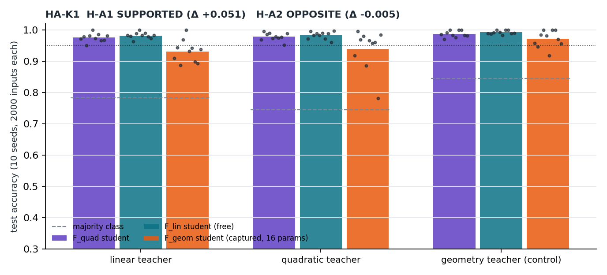

# HA-K1 results: the captured geometry restricts the decision class; extra quadratic capacity did not help

Protocol committed and pushed before execution: `PROTOCOL-HA-K1.md`, commit `57dc00229c4cfb47ccb12d34dc225a5953f28256` (GitHub activity: 2026-10-12T21:59:28Z; run start 21:59:34Z). One execution, exit 0, 2292 s on one CPU thread (CPython 3.13.7, NumPy 2.2.6, SciPy 1.15.1, scikit-learn 1.4.0). Raw output `results/HA_K1_RESULTS.json`, log `results/run01.log`, figure `results/ha-k1-capacity.png`. No deviation; all 10 seeds complete; every teacher theta and every kept student theta passed the fresh exact topology rebuild (0 invalid).

## Deterministic dimension facts (known before the run, recomputed)

Local decision dimension (detector forms modulo common shift and scale): **F_geom 12** at 20 random points of the translation box, **F_lin 26**, **F_quad 29**. Translations `c03, c13, c23, c33` have exactly zero effect on det.R0-R2: a quarter of the historically trained parameters cannot influence the three-class decision.

## Decisions

| | Mean test accuracy S_quad / S_lin / S_geom | Paired difference (mean, 95 % bootstrap) | One-sided Wilcoxon p, Holm p | Seeds won/tied/lost | Decision |
|---|---|---|---|---|---|
| **H-A1** on linear teachers | 0.9752 / **0.9818** / **0.9311** | S_lin - S_geom = **+0.0507** [0.0341, 0.0657] | 0.00195, 0.00391 | 9/1/0 | **SUPPORTED** |
| **H-A2** on quadratic teachers | **0.9779** / **0.9826** / 0.9394 | S_quad - S_lin = **-0.0046** [-0.0082, -0.0009] | 0.973, 0.973 | 3/1/6 | **OPPOSITE** to the prediction |
| **C-A3** control on geometry teachers | 0.9868 / 0.9918 / **0.9711** | - | - | - | **met** (>= 0.95) |

Majority-class rates were 0.783, 0.746 and 0.844; every student is far above them.

## Interpretation

1. **H-A1.** On tasks that the free linear optical class represents exactly, the captured 104-object geometry with its 16 translations loses about 5 accuracy points, in 9 of 10 seeds with one tie. This agrees with the dimension count (12 of 26 decision dimensions). Part of the gap is optimizer reach rather than representation: on its own realizable tasks the geometry student reaches 0.971 while the free linear student reaches 0.992, a 0.021 shortfall. The remaining gap of about 0.03 is the measured cost of the geometry restriction in this task family.
2. **H-A2.** The prediction failed. On quadratic-teacher tasks the free linear student was slightly **more** accurate than the quadratic logistic student. Because F_lin is a subset of F_quad, this cannot mean that the linear class represents more; it means that, with 400 training inputs and the fixed estimators of the protocol, the extra quadratic capacity did not become accuracy, and the rank-2 structure of the optical class acted as a useful restriction. The outcome concerns these estimators and sample sizes, not representational capacity.
3. **Consequence for the frontier hypothesis H-A.** The geometry is a real restriction of the linear optical class, so any advantage of Neuro3D must come from elsewhere (certification, robustness or cost), not from a richer function class. Activating the four inert translations, or adding translations that reach the R-detector rows, is the cheapest design change suggested by this result; it has not been tested.

## Limits

Synthetic teacher tasks with the historical encoding; represented scalar model evaluated on CPU (not native Blender or GPU); the captured scene is outside the diffraction-free regime (WAVE-C1), so nothing here is a physical-device statement; fixed student hyperparameters, so a larger optimizer budget could narrow the H-A1 gap.
