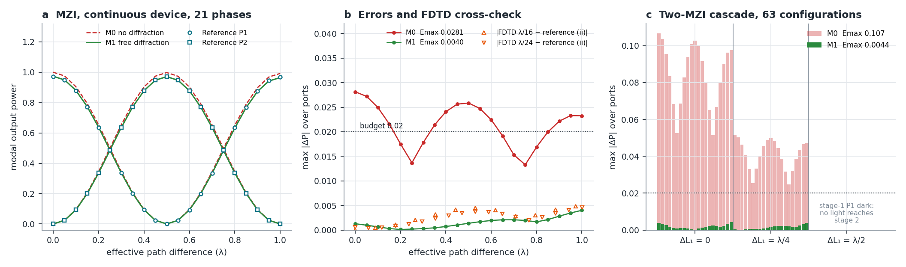
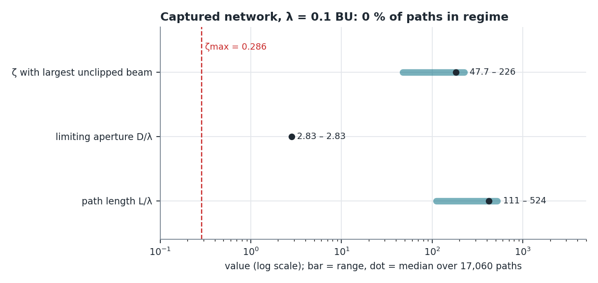

# WAVE-C1 results: diffraction-inclusive path model confirmed in the declared regime

Protocol committed and pushed before execution: `PROTOCOL-WAVE-C1.md`, commit `7327b67ab9be95ed92efa63a8a752df0d5e4a41a` (branch `claude/closure-guide-v2-20261012`). One execution, 12 October 2026, 21:43:30-21:43:37 UTC, exit code 0, 5.8 s of CPU on one thread (CPython 3.13.7, NumPy 2.2.6, SciPy 1.15.1, Windows 10). Raw output: `results/WAVE_C1_RESULTS.json`; log: `results/run01.log`; hashes: `results/SHA256SUMS.txt`. No deviation from the protocol.

## Decisions

| Hypothesis | Statistic | Budget | Result |
|---|---|---|---|
| Solver self-consistency (3 variants vs reference) | max abs(delta P) = 2.7e-15 | <= 1e-9 | met |
| Energy balance, all phases and variants | max abs(flux_out/flux_in - 1) = 3.3e-16 | <= 1e-9 | met |
| **H-C1**: M1 (free paraxial diffraction) | E_max = **0.00401** | <= 0.02 | **CONFIRMED** |
| **H-C0**: M0 (P1-7 model without diffraction) | E_max = **0.02813** | > 0.02 | **REPLICATED** |
| **H-C2**: archived FDTD vs reference, ideal FDTD-calibrated splitter (ii) | max abs(delta P) = **0.00482** (lambda/16), 0.00456 (lambda/24) | <= 0.005 | **SUPPORTED** |
| **H-C3**: two-MZI cascade, M1 | E_max = **0.00441** (M0: 0.1066) | <= 0.02 | **CONFIRMED** |

The predictions written in the protocol were about 0.005 for M1 and about 0.027 for M0. This was a confirmation with known exploratory values, **not a blind test**.

## What the result means

1. With a solver that shares no code with the P1-7 FDTD, represents the **same continuous device** at every resolution (no recalibrated index per mesh) and evaluates **all 21 phases exactly**, the P1-7 diagnosis is confirmed: the 2.7-3.1 % loss of modal power is free-space diffraction of the w = 8 lambda beam over about 95 lambda. A path model that adds paraxial Gaussian diffraction (no fitted parameter, the device's own centre-angle coefficients) stays within 0.0040 of the reference; the preregistered no-diffraction model fails at 0.0281, as in P1-7.
2. The archived FDTD powers agree with an exact free-space propagation of the same source through an ideal splitter carrying the FDTD-calibrated coefficients within 0.0048, close to but inside the 0.005 budget. The FDTD transfer is therefore explained by diffraction plus its calibrated splitter. With the **same refractive index** the agreement disappears (variant i: 0.098 at lambda/16, 0.020 at lambda/24): the discrete FDTD films behave like different continuous devices, as the per-mesh calibration (n = 2.427 and 2.485 instead of 2.537) already indicated. P1-7's convergence check therefore compared two recalibrated discrete devices; WAVE-C1 removes that limitation for the path-model question.
3. The cascade extends the result to a two-stage sub-network with about 190 lambda of propagation: M1 stays at 0.0044 while M0 errs by up to 0.107. **Scope note found after execution:** with stage-1 path difference lambda/2, stage 1 sends all light to its other port, so 21 of the 63 cascade configurations carry no light into stage 2 (powers about 1e-6) and test nothing. The decision is unchanged when only the 42 informative configurations are counted (E_max 0.0044); the design weakness is recorded, not repaired retrospectively.

## Primary sweep (reference solver, M0, M1)

| dL (lambda) | P1 ref | P2 ref | P1 M0 | P2 M0 | P1 M1 | P2 M1 | err M0 | err M1 |
|---|---|---|---|---|---|---|---|---|
| 0.00 | 0.97187 | 0.00000 | 1.00000 | 0.00000 | 0.97315 | 0.00000 | 0.02813 | 0.00128 |
| 0.05 | 0.94831 | 0.02388 | 0.97551 | 0.02447 | 0.94929 | 0.02379 | 0.02720 | 0.00098 |
| 0.10 | 0.87950 | 0.09295 | 0.90444 | 0.09548 | 0.88014 | 0.09284 | 0.02494 | 0.00064 |
| 0.15 | 0.77217 | 0.20046 | 0.79375 | 0.20607 | 0.77247 | 0.20036 | 0.02159 | 0.00030 |
| 0.20 | 0.63681 | 0.33592 | 0.65430 | 0.34538 | 0.63683 | 0.33582 | 0.01749 | 0.00010 |
| 0.25 | 0.48669 | 0.48608 | 0.49976 | 0.49976 | 0.48650 | 0.48594 | 0.01368 | 0.00019 |
| 0.30 | 0.33648 | 0.63625 | 0.34525 | 0.65405 | 0.33619 | 0.63600 | 0.01780 | 0.00029 |
| 0.35 | 0.20091 | 0.77174 | 0.20591 | 0.79313 | 0.20061 | 0.77129 | 0.02140 | 0.00045 |
| 0.40 | 0.09324 | 0.87928 | 0.09537 | 0.90338 | 0.09301 | 0.87857 | 0.02410 | 0.00071 |
| 0.45 | 0.02402 | 0.94836 | 0.02443 | 0.97399 | 0.02390 | 0.94732 | 0.02563 | 0.00103 |
| 0.50 | 0.00000 | 0.97221 | 0.00000 | 0.99805 | 0.00000 | 0.97083 | 0.02584 | 0.00137 |
| 0.55 | 0.02353 | 0.94849 | 0.02442 | 0.97323 | 0.02360 | 0.94680 | 0.02473 | 0.00169 |
| 0.60 | 0.09229 | 0.87955 | 0.09523 | 0.90197 | 0.09233 | 0.87761 | 0.02242 | 0.00194 |
| 0.65 | 0.19951 | 0.77212 | 0.20543 | 0.79128 | 0.19940 | 0.77004 | 0.01916 | 0.00208 |
| 0.70 | 0.33468 | 0.63673 | 0.34418 | 0.65201 | 0.33427 | 0.63465 | 0.01528 | 0.00209 |
| 0.75 | 0.48453 | 0.48663 | 0.49781 | 0.49781 | 0.48366 | 0.48469 | 0.01329 | 0.00194 |
| 0.80 | 0.63435 | 0.33650 | 0.65125 | 0.34377 | 0.63290 | 0.33484 | 0.01690 | 0.00166 |
| 0.85 | 0.76948 | 0.20101 | 0.78943 | 0.20496 | 0.76736 | 0.19974 | 0.01995 | 0.00212 |
| 0.90 | 0.87666 | 0.09340 | 0.89881 | 0.09490 | 0.87384 | 0.09259 | 0.02216 | 0.00282 |
| 0.95 | 0.94540 | 0.02416 | 0.96869 | 0.02431 | 0.94193 | 0.02380 | 0.02329 | 0.00347 |
| 1.00 | 0.96898 | 0.00000 | 0.99223 | 0.00002 | 0.96496 | 0.00002 | 0.02326 | 0.00401 |

Complex modal amplitudes and wrapped phase differences for every point are in the JSON. Solver-M1 wrapped phase differences are at most 0.0194 rad over the 39 port values whose amplitudes exceed the 0.05 dark floor; the values above 0.003 rad all occur at ports carrying at most 0.34 of the power, and the largest ones near P = 0.024. Dark ports are UNKNOWN by rule. The M1 error grows with the mirror displacement (0.0013 to 0.0040), which suggests the paraxial treatment of the displaced beam as its dominant residual; this is an observation, not a tested cause.

## S3: the captured network is far outside this regime

Declared criteria (3D circular Gaussian beam, no refocusing): no-diffraction power error <= 0.02, i.e. zeta = L lambda/(pi w^2) <= 0.2857, and clipping <= 1e-3 per axis, i.e. half aperture >= 1.645 w.

| Quantity (17,060 terminal paths; lambda = 0.1 BU) | min | median | max |
|---|---|---|---|
| Path length L/lambda | 110.7 | 423.2 | 523.9 |
| Limiting projected aperture D/lambda (4 lambda elements at 45 degrees) | 2.83 | 2.83 | 2.83 |
| zeta with the largest unclipped beam | 47.7 | 182.3 | 225.7 |

**No path of the captured network is in regime at its represented wavelength (0 of 17,060).** Every path would need lambda <= 1.27e-4 BU, about 790 times shorter than the represented 0.1 BU, or, at fixed lambda, apertures about 28 times wider relative to the path lengths. The scalar ray model of the captured scene is a well-defined represented model, with certified numerics; WAVE-C1 shows it is **not** a faithful wave description of that scene at its stated scale. Any physical claim about the captured network requires either a rescaled geometry inside the confirmed regime or a model that includes diffraction (M1 is the confirmed candidate in 2D). The 3D criterion is the separable extension of the 2D law tested here and is a modelling statement.

## Limits

2D scalar Ez; infinite planar elements (no edge diffraction, whose effect is bounded only indirectly by the 0.0048 FDTD agreement); lossless film and ideal conductor; one wavelength and w = 8 lambda; one geometry family. The confirmation is not blind. It does not validate the captured network, any fabricated device, polarization or 3D effects.

## Dated corrections after the independent red team (13 October 2026)

An independent verifier agent (no access to the producer's reasoning; report in `Docs/closure-20261012/claude/RED-TEAM-WAVE-C1-LEAN.md`) recomputed the MZI with its own direct plane-wave quadrature (max difference 1.4e-13 over 21 phases and 2 ports), 16 of the 63 cascade configurations (1.2e-13), the FDTD cross-check with a different window and sampling (3e-15), the captured-network regime (17,060 paths by dynamic programming) and the M0/M1 values with the frozen `haz_ideal` (< 1e-9). No number above is refuted. Four statements need correction; the original text is kept above:

1. **Cause of the M1 residual.** The sentence attributing the growth of the M1 error to "the paraxial treatment of the displaced beam" is wrong. With an ideal angle-independent splitter the solver and M1 differ by about 3e-5 at j = 0, 10 and 20; with the real slab the residual is 0.0013-0.0040. The paraxial diffraction law reproduces free propagation to about 3e-5; the remaining residual comes from the **angular dependence of the slab coefficients**, which M1 evaluates only at the central angle. This is a measured attribution by the red team, not part of the preregistered decision.
2. **Cascade scope.** The cascade is solved sequentially with infinite planar elements applied in the declared order. Infinite mirror planes of stages 1 and 2 would intersect other beams; with the finite 40-lambda elements of the P1-7 geometry a hand check finds no collision. H-C3 therefore confirms the diffraction-inclusive path law along the unfolded cascade, not a full-geometry wave simulation of it.
3. **FDTD cross-check margin.** H-C2 holds with a narrow margin (0.0048 against 0.005). The continuous 50/50 slab (variant iii) agrees with the archived FDTD better than the ideal splitter (0.0033 at lambda/16, 0.0023 at lambda/24).
4. **Constant.** The protocol rounds the clipping ratio to 1.6449; the code computes erfcinv(1e-3)/sqrt2 = 1.64526. No result changes.

Timing of the preregistration: GitHub's activity log records the branch creation with protocol commit `7327b67` at 2026-10-12T21:43:23Z; the run started at 21:43:30Z. The red-team also notes that the largest unclipped waist (0.86 lambda) is not paraxial, so the regime criterion errs in the direction that favours, not undermines, the conclusion that the captured network is outside the regime.
